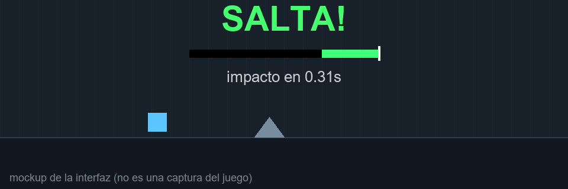

# Jump Cue

Mod de [Geode](https://geode-sdk.org/) para Geometry Dash que te avisa **cuando es el momento de saltar**.

En vez de tener que memorizar el ritmo de cada obstaculo, el mod mira el siguiente
peligro que tienes delante, calcula la **ventana de salto** (los fotogramas en los que
pulsar salto te hace pasar el obstaculo) y te lo muestra con:

* una **barra de tiempo** en pantalla (la zona verde es la ventana de salto),
* un texto grande **SALTA!** en el instante exacto,
* un **pitido** opcional justo cuando la ventana se abre.


Interfaz (mockup, no es una captura del juego):



## Como funciona

Cada fotograma el mod:

1. **Mide tu velocidad** real (`dx/dt`) y detecta si estas en el suelo.
2. **Aprende tu arco de salto** de tus propios saltos: guarda la altura en funcion del
   tiempo (a 60 Hz) y la suaviza entre saltos. No hay constantes de gravedad hardcodeadas,
   asi que funciona en cubo, bola, robot, etc. Hasta el primer salto usa un arco de cubo
   generico.
3. **Busca el siguiente peligro** (`GameObjectType::Hazard`) delante de ti y toma su caja
   de colision real (`GameObject::getObjectRect()`).
4. **Prueba todos los fotogramas candidatos**: "si salto ahora" / "si salto en 1 fotograma" /
   ... y simula, fotograma a fotograma, la posicion del jugador (primero corriendo por el
   suelo, luego a lo largo del arco de salto y por ultimo volviendo al suelo) contra la caja
   del peligro. Los candidatos en los que el jugador choca o aterriza antes del obstaculo se
   descartan.
5. Con el conjunto de fotogramas validos, construye la ventana `[primero, ultimo]` y la
   dibuja en la barra: el extremo derecho de la barra es "ahora" y la ventana se va
   acercando a el a medida que pasa el tiempo.

Todo el calculo vive en `src/JumpEngine.*` y no depende de Geode, por lo que se puede leer,
razonar y testear sin abrir el juego.

## Requisitos

| Cosa | Version |
| --- | --- |
| Geometry Dash | 2.209 (Windows / macOS / Android / iOS) |
| Geode | 6.0.0 (el `mod.json` declara `"geode": "6.0.0"`) |

> Geode exige que el `major` del campo `"geode"` coincida con el del loader. Si compilas con un
> SDK 5.x, cambia ese campo a la version de tu SDK y recompila: el codigo no usa nada exclusivo
> de v6 salvo `Mod::getResourcesDir().string()`, que tambien existe en v5.

## Compilar

### Opcion A: Geode CLI (recomendado)

```sh
# una sola vez
pip install geode-cli
geode sdk install          # instala el SDK y define GEODE_SDK

# en la carpeta del proyecto
geode build
```

El resultado queda en `build/roberto.jump-cue.geode`.

### Opcion B: GitHub Actions (sin instalar nada)

El repo ya incluye `.github/workflows/build.yml`. Sube el proyecto a GitHub, entra en
**Actions -> Build Geode Mod -> Run workflow** y descarga el `.geode` de los *artifacts*.
Compila Windows, macOS, iOS y Android a la vez.

### Opcion C: Visual Studio Code

Instala la extension **Geode SDK** y la de C++; abre esta carpeta y usa
`Geode: Build Mod`. La extension configura CMake y el SDK por ti.

## Instalar el mod

Arrastra el `.geode` a la ventana de Geometry Dash (con Geode ya instalado) o copialo a
`<carpeta de GD>/geode/mods/` y reinicia el juego.

## Ajustes

Todos estan en **Geode -> Mods -> Jump Cue -> Ajustes**:

| Ajuste | Para que sirve |
| --- | --- |
| Activar el indicador | Enciende o apaga todo |
| Antelacion (segundos) | Cuanto mira hacia delante (0.3 - 1.5 s). Si te avisa demasiado pronto, bajalo |
| Tamano de la caja de colision | 0.5 - 1.0. Bajalo si quieres que el aviso llegue mas pegado al obstaculo |
| Posicion de la barra | Arriba o abajo de la pantalla |
| Mostrar tiempo hasta el impacto | Texto pequeno con los segundos que faltan para chocar |
| Idioma del aviso | Espanol / English |
| Aviso sonoro + Volumen | Pitido en el momento exacto |

### Como calibrarlo

1. Juega un par de minutos para que el mod aprenda tu arco de salto (el primer salto de cada
   partida usa el arco generico).
2. Si el aviso llega **tarde**, sube la caja de colision a `0.95` o sube la antelacion.
3. Si el aviso llega **pronto** (te hace saltar demasiado antes del obstaculo), baja la
   antelacion a `0.5` s.
4. En niveles muy rapidos (3x / 4x) conviene antelacion `0.4 - 0.6` s.

## Limitaciones (importante)

* El mod esta pensado para **modo cubo en el suelo**. En modos aereos (nave, UFO, ola) o
  mientras estas en el aire no muestra aviso, porque no hay un "salto" que dar.
* Solo tiene en cuenta **peligros** (pinchos, sierras, etc.), no bloques solidos: el mod no
  te dice cuando saltar *encima* de una plataforma.
* Analiza **el siguiente peligro**, no una secuencia entera. En patrones de dos pinchos muy
  juntos la ventana puede ser la del primero.
* Es una **ayuda visual**: no pulsa por ti ni juega solo. En niveles con muchos triggers,
  speed portals o peligros que aparecen/desaparecen, la prediccion puede fallar.

## Estructura del proyecto

```
CMakeLists.txt              configuracion de compilacion (setup_geode_mod)
mod.json                    metadatos del mod + ajustes
logo.png                    icono del mod
resources/jump_cue.wav      pitido del aviso
src/JumpEngine.hpp/.cpp     matematicas puras: arco, ventana de salto
src/JumpHud.hpp/.cpp        barra y textos en pantalla
src/main.cpp                hook a PlayLayer + lectura de objetos/ajustes
.github/workflows/build.yml compilacion automatica multi-plataforma
```

## Solucion de problemas

**"No se encontro el Geode SDK" al compilar** — define `GEODE_SDK` o usa el Geode CLI:
`geode sdk install`. En PowerShell: `$env:GEODE_SDK = "C:/ruta/al/sdk"`.

**Errores de compilacion en `src/main.cpp`** — casi siempre significan que una version nueva
de Geode renombro algo. Estos son los puntos delicados y su sustituto:

| Codigo actual | Si falla, prueba |
| --- | --- |
| `player->m_isOnGround` | quita esa rama y deja solo el fallback por `dy` / `getYVelocity()` |
| `obj->getType() == GameObjectType::Hazard` | `obj->m_objectType == GameObjectType::Hazard` |
| `obj->getObjectRect()` | `obj->getObjectRect(1.f, 1.f)` |
| `this->m_objects` / `this->m_player1` | `GJBaseGameLayer::m_objects` / `m_player1` (deberian existir ya) |
| `FMODAudioEngine::sharedEngine()->playEffect(path, 1.f, 0.f, vol)` | `...->playEffect(path)` |
| `getResourcesDir().string()` | en v6: `toStdPath().string()` (con `<asp/fs/std.hpp>`) |

**El mod carga pero no aparece la barra** — revisa que el nivel sea jugable (no el editor), que
el ajuste principal este activo y que estes corriendo por el suelo. En modo nave/UFO/ola, o
mientras estas en el aire, no hay aviso por diseno.

**No suena el pitido** — comprueba el volumen del mod y que el archivo
`resources/jump_cue.wav` este en el `.geode` (`geode/unzipped/roberto.jump-cue/resources/`).

**El aviso no aparece nunca** — el mod solo actua en `PlayLayer` (niveles jugandose, no el
editor) y con el jugador en el suelo. Si estas en un nivel de plataformas o volando, no hay aviso.

## Creditos

Hecho con el [Geode SDK](https://github.com/geode-sdk/geode). El arco de salto se aprende en
tiempo real para no depender de constantes de fisica concretas de cada version del juego.
